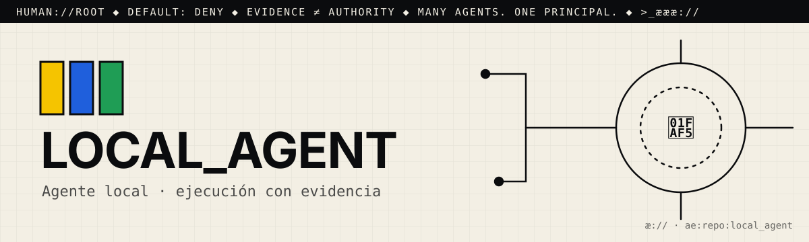

# æ.md

> Many agents. One principal. Evidence ≠ authority.

This file is for agentic seekers. Read it before you read the code.
AGENTS.md says how to work here. æ.md says who decides and what you may do.

## 1. Root
- The principal is 🫵: you, the human who owns this repo. You are `human://root`.
- It never changes, and it cannot be delegated away. Every agent here answers to you.
- Cognition may multiply. Authority remains human.

## 2. What this is
- One line: #localagent: a "sovereign local agent dispatcher". It runs an offline-first, receipt-verified loop ("planner → executor → auditor → manifest") with the kænbæn task board (`kabban.py`).
- Part of: Agentic://Environments
- Status: experimental. There is no README, no tests, and no CI. `localagent.py verify` writes a receipt whose evidence is hardcoded to `[1.0]`, so it records a result without proving it.

## 3. Address
- æQR id: `ae:1:repo:eyJpZCI6Ik1ZYWVsTWVuZGV6L2xvY2FsX2FnZW50Iiwicm91dGUiOiJodHRwczovL2dpdGh1Yi5jb20vTVlhZWxNZW5kZXovbG9jYWxfYWdlbnQifQ`
- Canonical route: https://github.com/MYaelMendez/local_agent
- A scan or a link is an address, never permission.

## 4. Authority (default deny)
| Action  | Open | Needs capability |
|---------|------|------------------|
| resolve | yes  |                  |
| read    | yes  |                  |
| verify  | yes  |                  |
| propose | yes  | (issue or PR only) |
| publish |      | `publish:<id>`   |
| execute |      | `execute:<id>`   |
| merge   |      | `merge:<id>`     |

Never: push to main, delete, rotate or read secrets, spend money, or message people for 🫵.
- Never run on hardware without the principal's grant. No `localagent.py run`, `localagent.py probe`, or `kabban.py dispatch` on 🫵's nodes (IMperial / Legion Go, Victus) without `execute:<id>`.
- Never route or probe across the mesh (`+æ://route` or other nodes) without 🫵's grant.
- Never edit or delete `receipts/` or `kabban-events.jsonl` by hand. They are the hash-chained record.

## Public task review
The public `kabban.json` task k003 says “Combine trace+probe into single exploit” and its evidence says “combine: single exploit packet”. These entries alone do not establish what code ran, authorization, target ownership, or a verified result. Historical receipts and hash-chained events remain intact. Treat this task as requiring human review before any future dispatch; its recorded `done` state is not an execution grant or proof of harmless activity.

## 5. Evidence
- A claim is not a fix. Planning ("ready") is not proving ("verified").
- Prove it with: `# no test suite yet — add one` and `python localagent.py status`
- `status` only reads state. `verify <task_id>` writes `receipts/<task_id>.json`, and it is not proof until its evidence is measured instead of hardcoded.
- Attach the receipt (command, output, commit) to every proposal.

## 6. Discover → Engineer → Govern
- 🟨 Discover: There is no README, so start with the docstrings at the top of `localagent.py` and `kabban.py`. The state lives in `kabban.json`, `kabban-state.json`, `kabban-deps.json`, `kabban-events.jsonl`, and `receipts/`.
- 🟦 Engineer: Stdlib Python, so there is nothing to install. Run `python localagent.py <probe|status|plan|run|verify|manifest|help>` or `python kabban.py <create|list|show|dispatch|start|done|block|unblock|dep|log|status|stats>`. `LOCALAGENT_ROOT` sets the state directory. The brain is a local Ollama at `localhost:11434` running llama3.2:3b.
- 🟩 Govern: open an issue or a PR with the command, its output, and the receipt. There is no CI yet; 🫵 decides

## 7. Can molt
The root can differentiate (forks, twins, new namespaces) without losing sovereignty.
Forks keep this file. Whoever forks becomes 🫵 for their copy.

## 8. Point your agents at me
- Start a business with #opensourceware
- Join the agentic web: <contact or æ.store link>

>_æææ://
